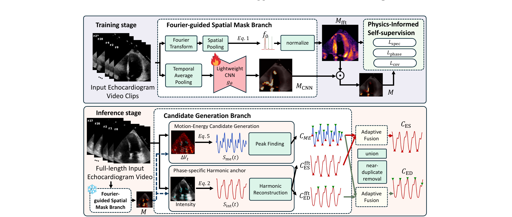
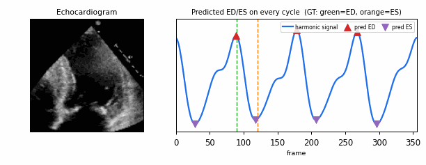

<div align="center">

# CardiacPULSE

**Frequency-Aware Self-Supervised Cardiac Phase Detection in Echocardiography** (MICCAI 2026)

<a href="LICENSE"></a>




</div>

CardiacPULSE detects end-diastole (ED) and end-systole (ES) frames in echocardiography **without labels, ECG, or segmentation**. A lightweight CNN learns a Fourier-guided spatial mask with self-supervised frequency-domain losses, and ED/ES frames are decoded from the resulting per-frame cardiac signals.

<div align="center"></div>

## Results

**EchoNet-Dynamic (A4C)**, MAE in ms:

| Method | Supervised | ED | ES | Avg |
|:--|:--:|:--:|:--:|:--:|
| R3D-50 | ✓ | 40.2 | 32.6 | 36.4 |
| MAEF | ✓ | 44.5 | 46.1 | 45.3 |
| UVT | ✓ | 139.2 | 65.0 | 102.1 |
| RepNet | ✗ | 97.1 | 135.5 | 116.3 |
| DDSB | ✗ | 83.4 | 175.4 | 129.4 |
| CardiacPhase | ✗ | 58.3 | 39.8 | 49.0 |
| **CardiacPULSE** | ✗ | **34.4** | **33.6** | **34.0** |

**CAMEO (9 views, macro-average)**: CardiacPULSE 41.2 ms vs. CardiacPhase 182.4 ms.

## Installation

```bash
git clone https://github.com/xmed-lab/CardiacPulse.git && cd CardiacPulse
conda create -n cardiacpulse python=3.10 && conda activate cardiacpulse
pip install torch==2.5.1 torchvision==0.20.1 --index-url https://download.pytorch.org/whl/cu124
pip install -r requirements.txt
```

## Data

- [EchoNet-Dynamic](https://echonet.github.io/dynamic/): `Videos/`, `FileList.csv`, `VolumeTracings.csv`.
- [CAMEO](https://dx.doi.org/10.21227/kvaz-eh57): one folder per patient, one sub-folder per view (`001/A4C/`, ...).

Pass the dataset path with `--data_root` (or set `ECHONET_ROOT` / `CAMEO_ROOT`).

## Usage

```bash
# Train on EchoNet-Dynamic
python train.py --config configs/echonet.yaml

# Evaluate on EchoNet-Dynamic
python evaluate.py --checkpoint /path/to/checkpoint.ckpt --data_root /path/to/EchoNet-Dynamic --split test

# Evaluate on CAMEO (all 9 views; one checkpoint per view under <dir>/<view>/)
python evaluate_cameo.py --results_dir /path/to/cameo_checkpoints --data_root /path/to/CAMEO
```

## Citation

If you find this work useful, please consider citing:

```bibtex
@inproceedings{guo2026cardiacpulse,
  title={CardiacPULSE: Frequency-Aware Self-supervised Cardiac Phase Detection in Echocardiography},
  author={Guo, Jiarong and Yang, Jiewen and Du, Yao and Qin, Yi and Li, Xiaomeng},
  booktitle={International Conference on Medical Image Computing and Computer-Assisted Intervention},
  pages={76--86},
  year={2026},
  organization={Springer}
}
```

Please also consider citing [CardiacPhase](https://github.com/YingyuYyy/CardiacPhase), which this work builds upon:

```bibtex
@inproceedings{yang2025latent,
  title={Latent motion profiling for annotation-free cardiac phase detection in adult and fetal echocardiography videos},
  author={Yang, Yingyu and Yang, Qianye and Cui, Kangning and Peng, Can and D’Alberti, Elena and Hernandez-Cruz, Netzahualcoyotl and Patey, Olga and Papageorghiou, Aris T and Noble, J Alison},
  booktitle={International Conference on Medical Image Computing and Computer-Assisted Intervention},
  pages={316--325},
  year={2025},
  organization={Springer}
}
```

## License

Unless otherwise noted, this repository is licensed under the [Creative Commons Attribution-NonCommercial 4.0 International](LICENSE) (CC BY-NC 4.0) license. The [official license text](https://creativecommons.org/licenses/by-nc/4.0/legalcode.txt) is included in `LICENSE` without modification.

Noncommercial use, modification, and redistribution are permitted under the license terms. When sharing the material or modified versions, give appropriate credit, retain the required notices, link to the license, and indicate any changes. **Commercial use is not permitted under this license** and requires separate permission from the relevant rights holders.

This work builds upon [CardiacPhase](https://github.com/YingyuYyy/CardiacPhase) by Yang et al. (MICCAI 2025), distributed under CC BY-NC 4.0. Its dataset-loading code has been adapted and integrated into CardiacPULSE; the original upstream license notice is preserved verbatim in [licenses/CardiacPhase-LICENSE](licenses/CardiacPhase-LICENSE). The existing attribution to [TVAE](https://github.com/alain-ryser/tvae) in `datasets/echonet.py` is retained.

Third-party material and dependencies retain their respective terms. EchoNet-Dynamic and CAMEO datasets are governed by their providers' terms; this repository's license does not grant rights to those datasets or override third-party terms. Separate permission for commercial use must cover any third-party material involved.
